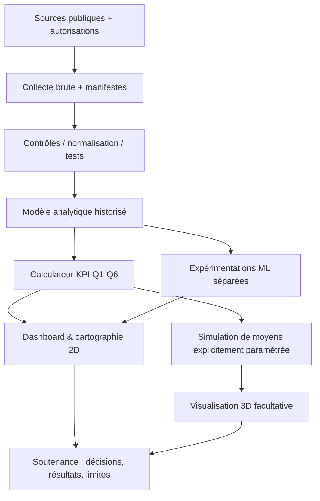

# Vision technique et feuille de route — Feux de forêt / SDIS 31

**Version :** V0, 20 novembre 2026. **Statut :** proposition d'architecture, à arbitrer avec l'équipe.  
**Rappel :** le SDIS 31 est le commanditaire **du cas pédagogique**, pas un partenaire opérationnel identifié.

## Notre principe

Nous ne voulons pas faire du « machine learning pour faire du machine learning », ni une scène 3D spectaculaire sans données. Chaque outil doit répondre à une question **Q1–Q6**, être testable, documenté et explicable à la soutenance. Nous sommes libres d'aller plus loin que la consigne technique, mais pas de masquer les limites des sources.

## Couches techniques envisageables

| Couche | Ce qu'elle apporterait | Conditions de mise en place | Priorité |
|---|---|---|---|
| **Ingestion et qualité** | BDIFF/MdF/INSEE/IGN, traçabilité, dates et référentiels | Licences, SHA-256, tests de qualité, CI | **Socle indispensable** |
| **Modèle décisionnel** | Étoile historisée, faits feux/jours dangereux, dimensions | Grains prouvés, jointures non ambiguës, temporalité | **Socle indispensable** |
| **Moteur de scénarios** | Seuils 2/3/4, horizons J+1/J+2, coût en jours de patrouille | Dénominateurs comparables, scénarios explicités | **V0 implémentée** |
| **Dashboard interactif** | Résultats compréhensibles, filtres et courbe coût/couverture | Tests navigateur, revue scientifique | **Prototype présent** |
| **Carte 2D** | Communes, feux, forêt, accessibilité/patrouilles | IGN/INSEE/limites territoriales et attribution corrects | **Après qualité géographique** |
| **Optimisation des ressources** | Proposer des placements sous contraintes de capacité/budget | Coûts et distances réelles ou hypothèses de simulation déclarées | **Phase de recherche** |
| **Modèle prédictif explicable** | Comparer probabilité empirique de journée avec feu et seuil officiel | Variables suffisamment riches, protocole temporel de validation, classes rares | **Expérimentation seulement** |
| **Simulation 2D** | Visualiser patrouilles sur une carte et arbitrages de couverture | Réseau routier et modèles de temps de parcours | **Option pédagogique forte** |
| **Simulation 3D** | Démonstrateur de terrain et scénarios visuels | Modèle numérique de terrain fiable et hypothèses de propagation explicites | **Bonus sous conditions** |

## Architecture cible modulaire

## Méthode pour les modèles ML

**D'abord un modèle de référence simple.** Si l'on utilise un modèle prédictif, la comparaison doit inclure les niveaux officiels 1–4 comme baseline, puis un modèle simple et explicable. Les événements sont rares dans la Haute-Garonne (1 événement type F en 2024 et 4 en 2025) : un modèle local entraîné sur ces seules données serait difficilement défendable.

- **Cible éventuelle :** journée départementale avec au moins un feu de type F, plutôt qu'un résultat individuel de propagation.
- **Données supplémentaires :** historiques plus longs de feux, météo opérationnelle compatible, occupation du sol, forêt ; variables disponibles **avant** la date cible.
- **Risque majeur :** fuite temporelle (utiliser une variable connue après l'incendie), biais de sélection saisonnier, forte disproportion classes sans feu/avec feu.
- **Séparation temporelle :** entraînement sur saisons antérieures et test sur saison postérieure ; ne pas mélanger aléatoirement les journées d'une même série sans justification.
- **Mesures :** rappel des journées avec feu, précision, faux déclenchements, calibration, coût de surveillance et comparaison avec seuil officiel ; pas uniquement accuracy.
- **Interprétabilité :** variables importantes, analyses d'erreurs, intervalles d'incertitude et limites de transfert vers le SDIS 31.

**La validation ne peut pas être réalisée avec les seules données actuelles.** Il faudra un historique et un protocole de test adaptés.

## Méthode pour les simulations 2D et 3D

Une première simulation crédible serait **la couverture de patrouilles**, pas un simulateur physique d'incendie. À partir d'un réseau routier, de postes/points de départ et de scénarios de disponibilité, nous pourrions afficher les secteurs couverts en N minutes, **en étiquetant clairement les hypothèses**.

La 3D pourrait représenter le relief et des couches forestières ; **sans données de vent, combustibles, humidité, topographie et modèle physique validé, nous ne simulerons pas la propagation des flammes comme un résultat scientifique**. Une belle animation ne doit pas être assimilée à une prévision.

## Ordre d'exécution recommandé

1. **Verrouiller la sémantique des dates Météo-France** et la provenance BDIFF (réserve TLS).
2. **Vérifier les KPI calculés** et leurs tests ; revue du groupe.
3. **Démontrer l'application interactive** sur le même CSV, puis améliorer la datavisualisation.
4. Collecter les référentiels IGN/INSEE et traiter Q1 (carte 2D cohérente).
5. Étudier l'optimisation de moyens Q5–Q6, avec données autorisées ou scénario explicitement simulé.
6. Envisager **ML**, puis **3D**, seulement si le gain par rapport aux besoins et au temps restant est démontré.

## Gestion de projet

- [Issue #9 : KPI et tests](https://github.com/Steve-Landry-NONO/feux-de-foret-occitanie/issues/9)
- [Issue #10 : application de démonstration](https://github.com/Steve-Landry-NONO/feux-de-foret-occitanie/issues/10)
- [PR #3 : sources, modèles, résultats et prototypes soumis à revue](https://github.com/Steve-Landry-NONO/feux-de-foret-occitanie/pull/3)

Les branches, commits, tickets et contributions individuelles doivent refléter **le travail réel des membres**, sans leur attribuer des avis qu'ils n'ont pas donnés.
