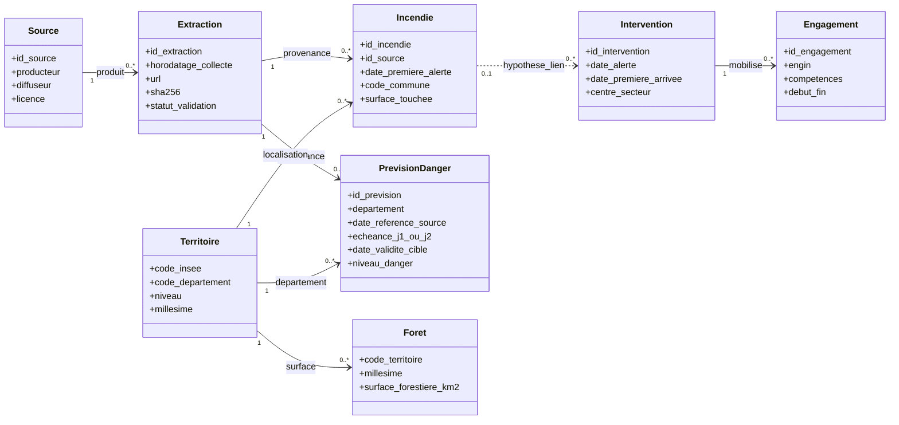
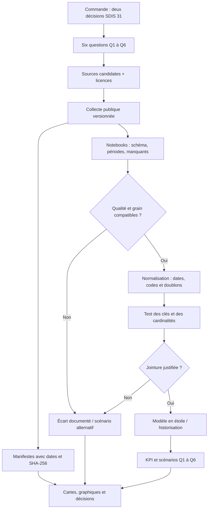
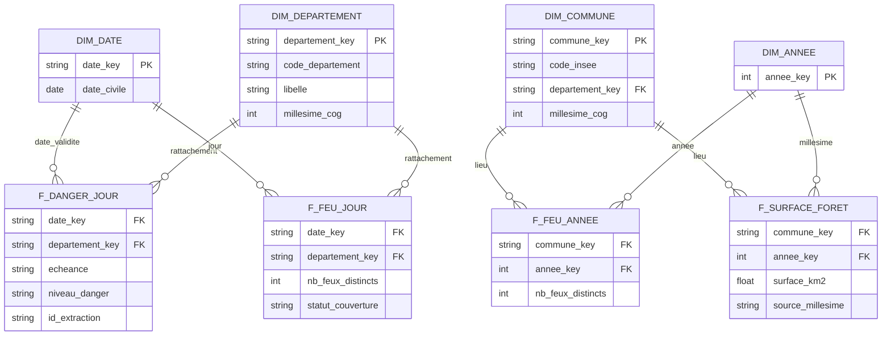

# Modélisation des données V0 — SDIS 31 (Occitanie)

**Date :** 19 novembre 2026 — **statut :** modèle conceptuel et logique **proposé, à confronter aux fichiers**.  
**Décision territoriale :** la **Haute-Garonne (31)** est notre terrain prioritaire ; Occitanie et France servent aux comparaisons compatibles.  
**Référence :** [spécification V1](../specification/specification-v1-2026-11-17.md), [Q1 à Q6](../collectif/questions-retenues-proposition.md), [fichiers météo réellement collectés](../../datasets/public/meteo_des_forets/README.md), [tickets de modélisation](https://github.com/Steve-Landry-NONO/feux-de-foret-occitanie/issues/6).

> On représente d'abord ce qui sert à décider ; chaque clé, relation et agrégation doit ensuite être justifiée dans les notebooks. Ce schéma n'est **ni une base en production ni un UML déjà approuvé par tous**.

## 1. UML conceptuel : les entités et leurs liens



**Observé sur les archives météo :** colonnes 'date', 'num_dep', 'niveau_j1', 'niveau_j2' et 'nom_dep' (nom de colonne différent en 2025) ; elles **ne fournissent pas directement** une colonne date_validité explicitement libellée. La transformation 'date référence + échéance' est **hypothétique** tant que la documentation ne l'a pas confirmée.

**Observé sur la couche secondaire ArcGIS dérivée de BDIFF :** présence annoncée par son schéma de 'Date_de_premiere_alerte', 'Departement', 'Code_INSEE', 'Numero' et de champs de surface. Les observations de cette couche doivent être téléchargées, contrôlées puis comparées à l'export original BDIFF.

**Non établi :** un identifiant commun entre feu et intervention SDIS, l'accès aux moyens, les engagements réels et les coûts.

## 2. Flux de collecte, de qualité et de décision



La première étape automatisée est réellement en place pour Météo-France. Les étapes suivantes **doivent être validées par les tests**, et non supposées terminées parce que le diagramme existe.

## 3. Modèle décisionnel provisoire (constellation de faits)



**Grains ciblés :**

| Fait | Grain | Usage | Condition |
|---|---|---|---|
| F_DANGER_JOUR | département × **date de validité** × échéance choisie | Q2, Q3, Q4 | Sémantique des archives météo à confirmer ; pas de lignes dupliquées |
| F_FEU_JOUR | département × date locale | Q2, Q3, Q4 | 1 feu ou plus = **une journée avec feu**, pas plusieurs journées |
| F_FEU_ANNEE | commune × année | Q1, Q4 | Couverture et codes commune contrôlés |
| F_SURFACE_FORET | commune × millésime forestier | Q1, Q4 | Relevé IGN comparable ; surface inconnue ≠ zéro |
| F_INTERVENTION (à venir) | une intervention | Q5 | Accès aux dates d'alerte/arrivée SDIS |
| F_ENGAGEMENT (à venir) | un moyen engagé × intervalle | Q6 | Accès aux ressources et disponibilités |

**Attention :** on ne descend pas un niveau météo départemental au grain communal par duplication. Une valeur départementale ne devient pas une mesure du risque de chaque commune.

## 4. Matrice de traçabilité Q1–Q6

| Question | Données nécessaires | Sortie finale attendue | État |
|---|---|---|---|
| Q1 | Feux localisés + IGN forêt + COG INSEE | Fréquence annualisée par km² forestier + carte du 31 | IGN/INSEE non encore profilés |
| Q2 | Jours de feux + danger prévu à date comparable | Couverture de chaque seuil / jours manqués | Date J+1/J+2 et export BDIFF à valider |
| Q3 | Niveaux quotidiens + jours de feux + coût si accessible | Jours de renforcement / compromis budget | Coût réel indisponible ; proxy de jours envisageable |
| Q4 | Séries homogènes sur périodes communes | Comparaison 31 / Occitanie / France | Millésimes et recensements à homogénéiser |
| Q5 | Alertes/arrivées/centres/capacités SDIS | Délais et secteurs sous-couverts | Accès non confirmé |
| Q6 | Intervalles d'engagement / engins / effectifs | Simultanéité et besoins supplémentaires | Accès non confirmé ; simulation distincte |

## 5. Registre des points de jointure à faire évoluer

| Jointure candidate | Test à réaliser | Risque | Statut |
|---|---|---|---|
| Feu × météo | département + jour **de validité** de l'échéance retenue, plage temporelle, 1:1 côté météo | doublons et décalage J+1/J+2 | **À vérifier** |
| Feu × INSEE COG | code commune en texte + année/millésime | anciennes communes, codes perdus | **À vérifier** |
| Commune × IGN surface forestière | code commune après intersection géospatiale | dénominateur incohérent | **À vérifier** |
| Statistiques SIS × territoire | département × année | grain annuel ≠ événement | **À vérifier** |
| Incendie × intervention SDIS | identifiant **vérifié**, sinon géotemporalité documentée | faux liens | **Bloqué par l'accès** |
| Intervention × engagement | identifiant intervention × intervalle | simultanéité artificielle | **Bloqué par l'accès** |

Pour chaque test effectivement exécuté, nous renseignerons l'empreinte des sources, le nombre de lignes avant/après, la cardinalité attendue, les doublons, les non-raccordés, la date du contrôle et le membre ayant fait la revue.

## 6. Points à décider au prochain contrôle

1. Quel champ météo correspond **à la journée de danger utile pour décider** ? J1 et J2 doivent être documentés par Météo-France.
2. Quelle source incendie fait foi pour 2024 et 2025 ? La couche ArcGIS est **secondaire**, et l'export BDIFF doit être comparé avant validation.
3. Quel référentiel géographique et forestier peut fournir un dénominateur défendable pour le 31 ?
4. Q5/Q6 : données opérationnelles réellement obtenables, ou scénarios explicitement simulés ?
5. Qui accepte les revues : Maeva (source), Chantal (qualité), Stéphane (ETL), Ludovic (KPI/modèle), Steve (cohérence) ? Pas de validations inventées.

**Issue de suivi :** [#6 — UML et schéma étoile](https://github.com/Steve-Landry-NONO/feux-de-foret-occitanie/issues/6).

## 7. Validation de la règle temporelle Météo-France — 20 novembre 2026

La [documentation métier du producteur](https://confluence-meteofrance.atlassian.net/wiki/spaces/OpenDataMeteoFrance/pages/874741792/Donn%2Bes%2Bexpertis%Bes) confirme que les prévisions Météo des forêts sont publiées vers **17 h**, pour le **lendemain (J+1)** et le **surlendemain (J+2)**. Les quatre codes sont faible=1, modéré=2, élevé=3, très élevé=4.

**Règles de transformation implémentées :**

```text
Archive : (date de référence = D, département = 31, niveau_j1 = 3, niveau_j2 = 4)
    ├─ (département=31, date_validité=D+1, échéance=J+1, danger=3)
    └─ (département=31, date_validité=D+2, échéance=J+2, danger=4)

BDIFF : (département=31, date_première_alerte=T)
Jointure  : département identique + date_validité = date(T) + échéance CHOISIE
```

Pour une décision prise le **soir précédent le jour de patrouille**, retenir **J+1** émis la veille ; pour un arbitrage deux jours avant, examiner **J+2**. Éviter de sélectionner a posteriori la meilleure des deux prévisions pour augmenter artificiellement la sensibilité.

**Réserve de schéma :** la documentation appelle le champ de production `Reference_time` (avec heure), mais nos archives comportent `date` (sans heure). L'analogie est forte ; la correspondance formelle entre ces libellés reste à confirmer. La production à 17 h est une règle générale, pas un horodatage de chaque ligne de nos fichiers.

**Audit exécuté :** [validation_j1_j2_v1.md](../resultats/validation_j1_j2_v1.md) et [script Python](../../scripts/valider_echeances_mdf.py). Le résultat vérifie des **raccords de données**, pas encore un taux de couverture de seuil ou un coût de mobilisation.

**Portée des résultats :** Météo-France précise que la **Météo des forêts est un produit de prévention grand public**, différent de l'assistance opérationnelle apportée aux SIS. Les scénarios Q2–Q3 sont des modèles pédagogiques d'aide à la discussion, **pas une instruction officielle de déclenchement du SDIS 31**.
