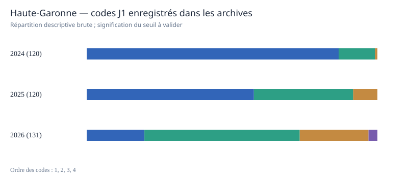

# Profilage des sources — constats reproductibles

**Données mesurées depuis les fichiers ; aucune recommandation opérationnelle n'est encore validée.**

## Archives Météo des forêts

| Année | Lignes | Départements | Départements d'Occitanie | Dates | Min | Max | Dates invalides | Doublons clé |
|---|---:|---:|---:|---:|---|---|---:|---:|
| 2024 | 11520 | 96 | 13 | 120 | 2024-06-03 | 2024-09-30 | 0 | 0 |
| 2025 | 11520 | 96 | 13 | 120 | 2025-06-03 | 2025-09-30 | 0 | 0 |
| 2026 | 12576 | 96 | 13 | 131 | 2026-05-28 | 2026-10-05 | 0 | 0 |

Les colonnes, codes J1 et valeurs manquantes sont listés dans le [JSON d'audit](profilage_sources_v1.json).

## Source incendies dérivée BDIFF / Esri

| Année | Statut | Lignes | Événements retenus | Dates manquantes |
|---|---|---:|---:|---:|
| 2024 | derive_BDIFF_Esri_non_recoupe_avec_original | 413 | 413 | 0 |
| 2025 | non_collecte | — | — | — |

## Jointure exploratoire de même date — non validée pour Q2 et Q3

| Année | Jours avec feu | Raccord météo même date | Sans raccord | Jours avec feu 31 | Raccord 31 |
|---|---:|---:|---:|---:|---:|
| 2024 | 289 | 161 | 128 | 1 | 0 |
| 2025 | 0 | 0 | 0 | 0 | 0 |

**Important :** même date n'implique pas même date de validité de la prévision. Aucun ratio de couverture des seuils n'est publié tant que le producteur n'a pas clarifié cette sémantique.

## Contrôles restant ouverts

- Maeva : vérifier la concordance avec l'export BDIFF officiel (source secondaire Esri).
- Chantal : relire licences, lacunes et périmètre d'usage.
- Stéphane : vérifier la cardinalité et les doublons de la clé de rapprochement.
- Ludovic : confirmer les dates de validité J1/J2 avant les KPI.
- Steve : tracer les conclusions dans les tickets et la PR.

Ces noms désignent des relectures **proposées**, pas des validations déjà effectuées.
